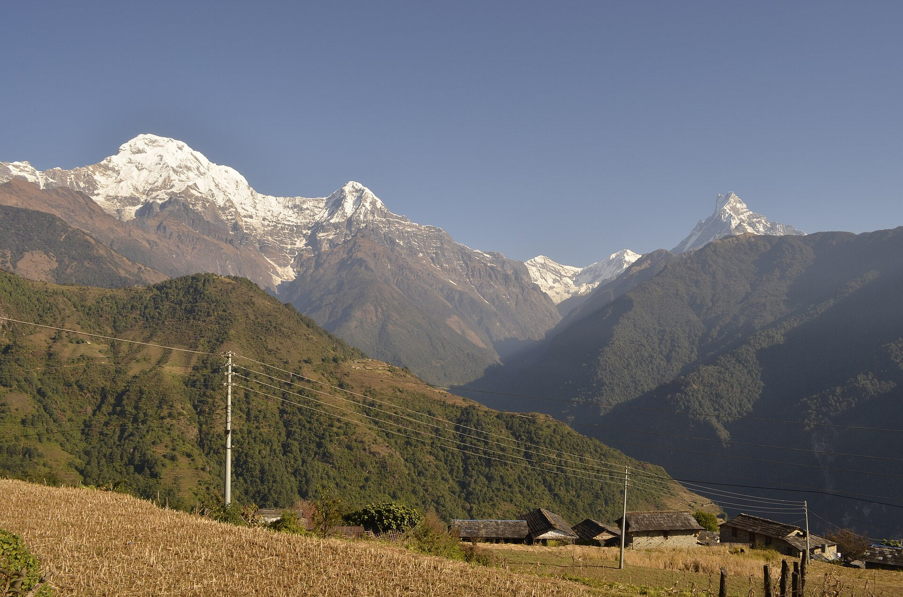

 <div align="center">

# 🏔️ TAMU

### The living history of the Gurung people

_Not a Wikipedia article. Not a museum plaque._  
_A place to actually read, wander and understand._

<br/>

<sub>✦ An independent passion project, made in spare time ✦</sub>

<sub>This isn't a full-time operation or a formal institution. It's a personal project built out of curiosity and a love for Gurung heritage. Updates happen whenever time and inspiration allow — no fixed schedule, no promises. Just keeping our stories alive.</sub>

<br/>

**[🌐 Explore TAMU](https://tamu.one)** · [✉️ Say hello](mailto:hello@tamu.one)

<br/>

[](LICENSE)
[](https://tanstack.com/start)
[](CONTRIBUTING.md)
[](https://tamu.one)

<br/>

</div>

<p align="center">
  
  <sub><em>Annapurna South and Machapuchare from Ghandruk — a landscape connected to the stories within TAMU.</em></sub>
</p>

---

## ✦ Why TAMU exists

Most people meet Gurung culture as a footnote — a line about Gurkha soldiers, a festival photo with no caption, a language described as "spoken by some communities in Nepal".

But there's so much more.

Our history, traditions, language, migration, beliefs and everyday stories are scattered across oral traditions, old journal articles, family memories and hard-to-find books.

**TAMU brings those pieces together in one place.**

Five collections — **History, Culture, Language, Geography and Diaspora** — open into a sourced knowledge library, a timeline you can walk through, a photographic archive where every image credits its creator and licence, and a journey designed to be read from beginning to end.

The idea is simple: make Gurung heritage easier to explore, understand and pass on.

_It's built to be read for an hour, not skimmed for ten seconds._

## ✦ What makes it different

### 📚 Evidence you can follow

Articles aren't just summaries of summaries. Each one includes sources, an indication of evidence strength, a last-reviewed date and a visible community-review line.

When evidence is limited, we say so. When scholars disagree, the disagreement stays visible.

### 🎨 Reading, designed

A little museum atmosphere, without the museum stiffness.

Full-width photography, Cormorant headings over Karla text, continuous reading on subject pages, and layouts designed to let the stories breathe.

Inline and standalone reading modes share the same citations.

### 🧬 Community knowledge matters

A family account and a published academic paper are different kinds of evidence, and both deserve to be preserved with the right context.

The **Contribute** and **Oral History** pages provide a place for knowledge held by people, not just libraries and archives.

### 📷 Photography with proper credit

Every image in `public/images` records its creator, licence, licence URL and original Commons file.

No anonymous image collections. No pretending someone else's work is ours.

### ⚡ Fast, static and private

Server-rendered pages, no visitor accounts, no tracking cookies and a single cookieless visit count from Cloudflare.

The museum is built from its own content and code.

---

## ✦ Explore the museum

| Collection                                   | What's inside                                                              |
| :------------------------------------------- | :------------------------------------------------------------------------- |
| [`/`](https://tamu.one/)                     | **The entrance** — five collections, one landscape                         |
| [`/journey`](https://tamu.one/journey)       | A continuous read from origins to the diaspora                             |
| [`/history`](https://tamu.one/history)       | Origins, Kohla, Ghale traditions and Gurkha service                        |
| [`/culture`](https://tamu.one/culture)       | Ghatu, Rodhi, Pachyu and Ghyabre, Tamu Lhosar, weaving and oral literature |
| [`/language`](https://tamu.one/language)     | Tamu Kyi, language variation, Gurung Khema and documentation               |
| [`/geography`](https://tamu.one/geography)   | Ghandruk, Manang, Sikles, terraces, pastures and changing villages         |
| [`/diaspora`](https://tamu.one/diaspora)     | Britain, Hong Kong, New York, India and beyond                             |
| [`/library`](https://tamu.one/library)       | Articles searchable by topic, region and evidence                          |
| [`/timeline`](https://tamu.one/timeline)     | Dated events connected to their sources                                    |
| [`/archive`](https://tamu.one/archive)       | A photographic collection with full credits                                |
| [`/sources`](https://tamu.one/sources)       | The references behind the museum                                           |
| [`/contribute`](https://tamu.one/contribute) | A place to share knowledge and stories                                     |
| [`/about`](https://tamu.one/about)           | How the project handles evidence                                           |

---

## ✦ Run it locally

You'll need [Bun](https://bun.sh).

```sh
git clone https://github.com/g0GobliN/tamu.git
cd tamu
bun install
bun run dev
```

Open `http://localhost:3000`.

### Available commands

| Command             | Purpose                                    |
| :------------------ | :----------------------------------------- |
| `bun run build`     | Production build (also writes sitemap.xml) |
| `bun run sitemap`   | Regenerate `dist/client/sitemap.xml`       |
| `bun run preview`   | Preview the production build               |
| `bun run test`      | Run Vitest                                 |
| `bun run typecheck` | TypeScript checks                          |
| `bun run lint`      | ESLint + Prettier                          |
| `bun run format`    | Format source files                        |

CI runs lint, typecheck, tests and a production build on every pull request.

---

## ✦ Deployment

TAMU runs as a Cloudflare Worker with static assets.

Pages are rendered at the edge, assets are served from the same deployment, and `tamu.one` is the production domain.

```sh
bun run build    # Build Worker + client assets
bun run cf:dev   # Run the built Worker locally in workerd
bun run deploy   # Build and publish with Wrangler
```

`wrangler.jsonc` defines the Worker, entry point and assets directory. No extra deployment flags or repository secrets are needed for the standard deployment.

The live site publishes from `main` through Cloudflare Workers Builds. Forks can deploy into their own Cloudflare accounts and connect their own domains.

### Visitor analytics

Visits are counted by Cloudflare Web Analytics, read from the same Worker deployment. It answers the questions the project actually needs: how many people came, which pages they read, which sites sent them and which country they connected from. It is cookieless, sets nothing on the reader's device and reports aggregate numbers rather than people.

1. In the Cloudflare dashboard open **Analytics & Logs → Web Analytics**, add the site (`tamu.one` or the `workers.dev` hostname) and copy its beacon token.
2. Add the token to the build as `VITE_CF_ANALYTICS_TOKEN` — in Workers Builds under **Settings → Build variables**, or in a local `.env` file.
3. Rebuild or redeploy. The token is public: it identifies the site, not a person.

Without the variable the beacon script is never added and the site collects nothing. Reports appear in Web Analytics a few minutes after the first visits; the same page shows top pages, referrers, countries, browsers and Core Web Vitals.

---

## ✦ Under the hood

A little bit of modern web technology, a lot of reading and research.

| Technology                                     | Role                                       |
| :--------------------------------------------- | :----------------------------------------- |
| [TanStack Start](https://tanstack.com/start)   | Application framework and server rendering |
| [TanStack Router](https://tanstack.com/router) | Routing                                    |
| React 19                                       | UI                                         |
| Vite 8                                         | Development and builds                     |
| TypeScript                                     | Type safety                                |
| Tailwind CSS v4                                | Styling                                    |
| shadcn/ui + Radix                              | Interface primitives                       |
| Motion + GSAP                                  | Animations and interactions                |
| Vitest + Testing Library                       | Tests                                      |
| Cloudflare Workers                             | Production hosting                         |

### Project structure

```text
content/               # All of the words, outside the application code
├── library/           # One Markdown file per article, English and Nepali
│   ├── history/  language/  culture/
│   ├── spirituality/  homeland/  diaspora/
├── collections/       # Collection-page intros and theme lists (JSON)
├── timeline.json      # Dated events, both languages
├── sources.json       # Bibliography cited by the articles
└── README.md          # How to edit, add and reuse the content

src/
├── components/
│   ├── museum/       # Home, TopicPage, Library, ArticlePage,
│   │                 # Header, Footer and museum components
│   └── ui/           # shadcn/ui primitives
├── data/             # Library loaders, media and legal text
├── lib/              # SEO, error handling and utilities
├── routes/           # Thin routes and page metadata
└── styles.css        # Theme tokens and museum styles

public/
└── images/           # Locally hosted photographs
```

Every article is a single Markdown file in `content/library/<subject>/`, holding its metadata, sources and both language versions. Adding one there makes it available in the library, its subject page, search and the sitemap — no code change. See [`content/README.md`](content/README.md) for the format.

---

## ✦ How to get involved

TAMU is a small project, but it doesn't have to stay a one-person effort.

You don't need to be a developer, historian or academic to help.

### ❤️ Support the project

- **Star the repository.** A tiny click that helps the next person discover it.
- **Share an article.** Send the Ghandruk piece to someone from Kaski, or the Tamu Kyi page to someone raising children abroad.
- **Report something wrong.** A misread source, a village name spelled incorrectly or a photograph credited to the wrong person — corrections are welcome.
- **Share your knowledge.** Family accounts, recordings, photographs you own, local histories and overlooked sources all have a place here.
- **Help with code.** Accessibility, performance, new reading features and tests are all useful contributions.

### 🌱 What can you contribute?

| Contribution | Examples                                              |
| :----------- | :---------------------------------------------------- |
| Stories      | Family memories, village histories, oral traditions   |
| Photographs  | Old family photos, historical places, cultural events |
| Language     | Tamu Kyi vocabulary, translations and variations      |
| Culture      | Festivals, music, rituals, clothing and traditions    |
| Research     | Books, academic papers, documents and references      |
| Corrections  | Names, dates, spellings and historical context        |
| Code         | Features, accessibility, performance and bug fixes    |

For knowledge and heritage contributions, see [CONTRIBUTING.md](CONTRIBUTING.md).

For code contributions, the same guide explains the development workflow.

**You don't need permission to care about this. Open an issue and say hello.**

---

## ✦ Contributing guidelines

Every code change follows one path:

**Issue → Discussion → Pull Request → Review → Merge**

Direct pushes to `main` don't happen.

The rules, CI checks and sourcing standards are in [CONTRIBUTING.md](CONTRIBUTING.md).

[CODE_OF_CONDUCT.md](CODE_OF_CONDUCT.md) explains how we treat each other here.

Found a security vulnerability? Report it privately through [SECURITY.md](SECURITY.md), never in a public issue.

---

## ✦ Licence & credits

### Application code

Licensed under the [Apache License 2.0](LICENSE).

### Photographs and media

Photographs are **not** covered by the application code licence. They remain under the individual Creative Commons licences recorded in [`src/data/media.ts`](src/data/media.ts), including CC BY and CC BY-SA where applicable.

Each image includes its creator, licence and original source.

### Article content

Article text is editorial content of the project, with sources cited per article. Its terms are distinct from the application code licence.

See [NOTICE](NOTICE) for the exact licensing scope.

---

<div align="center">

## 🏔️ The mountains are still there. So is the knowledge.

_Our past. Our people. Our stories._

<br/>

**If you found something worth reading, pass it on.**

Give the repository a star, share a story, or simply spend a little time exploring.

<br/>

[**Visit TAMU →**](https://tamu.one)

<sub>Made with curiosity, a little spare time, and a connection to the mountains.</sub>

<br/>

<sub>© TAMU · An independent heritage project</sub>

</div>
